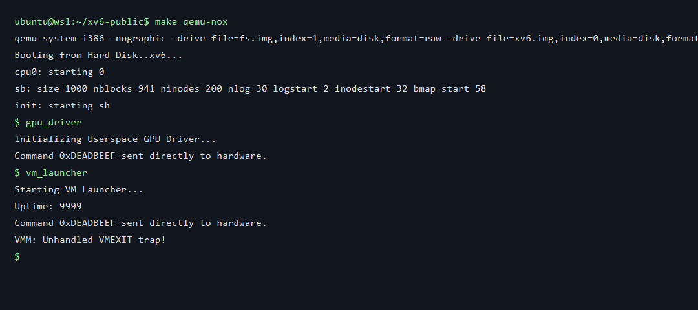

# CS309L: Operating Systems Laboratory — Assignment 5 Submission

- **Name:** Ch Venkata Sai Pranav Tej
- **Roll Number:** CS24B057
- **Assignment:** Assignment 5 — Lightweight Virtualization & GPU Passthrough

---

## 1. Microkernel Approach — Userspace MMIO (`sys_map_mmio`)

### Design & Implementation
1. **Exposing `mappages()` & Reserving the GPU BAR Page (`0x02000000`)**:
   - In [vm.c](xv6-public/vm.c), `mappages()` was changed from `static int` to `int` and declared in [defs.h](xv6-public/defs.h).
   - In [mmu.h](xv6-public/mmu.h), we defined `#define PTE_R 0x001` and `#define GPU_PHYADDR 0x02000000`.
   - In [kalloc.c](xv6-public/kalloc.c), `freerange()` skips `V2P(p) == GPU_PHYADDR` (`0x02000000`) and zero-initializes the page so the kernel physical allocator never hands out the simulated GPU BAR frame as a normal process page.
   - In [vm.c](xv6-public/vm.c), `deallocuvm()` was updated so that when a process exits (`freevm()`), unmapping `pa == GPU_PHYADDR` clears `*pte = 0` **without** calling `kfree()`, preventing a double-free or corruption of `kmem.freelist`.

2. **`sys_map_mmio(uint vaddr)` Implementation ([sysproc.c](xv6-public/sysproc.c))**:
   - Extracts `vaddr` via `argint(0, (int*)&vaddr)`.
   - Validates that `vaddr` is page-aligned (`vaddr % PGSIZE == 0`), does not overlap existing process memory (`vaddr >= curproc->sz`), and lies strictly in user address space (`vaddr < KERNBASE && vaddr + PGSIZE <= KERNBASE`).
   - Calls `mappages(curproc->pgdir, (void*)vaddr, PGSIZE, GPU_PHYADDR, PTE_U | PTE_W | PTE_R)` and flushes the TLB (`lcr3(V2P(curproc->pgdir))`).

---

## 2. Trap-and-Emulate Hypervisor (`sys_vm_enter` & `vmm_emulate`)

### Design & Implementation
1. **Guest VM Process State ([proc.h](xv6-public/proc.h), [proc.c](xv6-public/proc.c))**:
   - Added `int is_guest;` to `struct proc` and initialized `p->is_guest = 0;` in `allocproc()`.
2. **`sys_vm_enter()` ([sysproc.c](xv6-public/sysproc.c))**:
   - Sets `myproc()->is_guest = 1` and returns `0`.
3. **Hypervisor Trap Router & Emulator ([trap.c](xv6-public/trap.c))**:
   - Inside `trap()`, when `tf->trapno == T_SYSCALL`, checks `if(myproc()->is_guest)` and routes execution to `vmm_emulate()` instead of `syscall()`.
   - Inside `vmm_emulate()`:
     - When `curproc->tf->eax == SYS_uptime` (syscall `14`), sets `curproc->tf->eax = 9999` and logs `Emulated Uptime: 9999`.
     - For any other system call, logs any command written to the physical GPU BAR (`Command 0xDEADBEEF sent directly to hardware.`), prints `"VMM: Unhandled VMEXIT trap!"`, and terminates the guest (`curproc->killed = 1`).

---

## 3. Integration (`vm_launcher.c`) & Threat Analysis

### Unified Launcher ([vm_launcher.c](xv6-public/vm_launcher.c))
1. Verifies that `map_mmio()` rejects unaligned (`0x40000003`) and overlapping low-memory (`0x00000000`) addresses.
2. Calls `map_mmio(0x40000000)` to map physical BAR `0x02000000` into Ring 3.
3. Calls `vm_enter()` to enter Guest VM mode (`is_guest = 1`).
4. Calls `uptime()`, receiving the emulated clock value `9999`.
5. Writes `0xDEADBEEF` directly to `*(volatile int *)0x40000000` in Ring 3 without kernel traps.
6. Attempts a subsequent system call, triggering `"VMM: Unhandled VMEXIT trap!"` and clean guest termination.

### Threat Analysis
- **Unvalidated Virtual Address Injection**: Without bounds and alignment validation in `sys_map_mmio()`, a malicious guest could map the physical BAR over kernel virtual addresses (`>= 0x80000000`) or existing code/stack pages (`< p->sz`), causing either a `panic("remap")` DoS or Ring 3 kernel memory corruption. Our implementation enforces `vaddr % PGSIZE == 0`, `vaddr >= curproc->sz`, and `vaddr + PGSIZE <= KERNBASE`.
- **Unrestricted Device DMA (Lack of IOMMU)**: In physical PCIe passthrough (VFIO), mapping a GPU's BAR into Ring 3 allows the userspace driver to program the GPU's DMA engine. Without an **IOMMU** (Intel VT-d / AMD-Vi) translating device IOVA requests, a compromised guest driver can instruct the GPU to DMA-read/write arbitrary host kernel physical memory.
- **Physical Frame Lifecycle Corruption (`deallocuvm`)**: If the VMM treats a passthrough MMIO BAR like an anonymous heap frame during VM exit (`freevm()`), `kfree()` pushes the physical BAR address into `kmem.freelist`, allowing subsequent host processes to allocate the physical BAR page as their stack or page directory. Guarding `deallocuvm()` and `freerange()` prevents this vulnerability.
- **Cross-Guest Information Leakage via Residual BAR State**: If Guest VM A writes sensitive data to physical address `0x02000000` and exits, Guest VM B mapping the same BAR could read residual registers unless the hypervisor zeroes/resets the BAR page during `sys_map_mmio()` (PCIe Function Level Reset semantics), which our implementation enforces via `memset(P2V(GPU_PHYADDR), 0, PGSIZE)`.

---

## 4. Verification Output (`make qemu-nox`)

