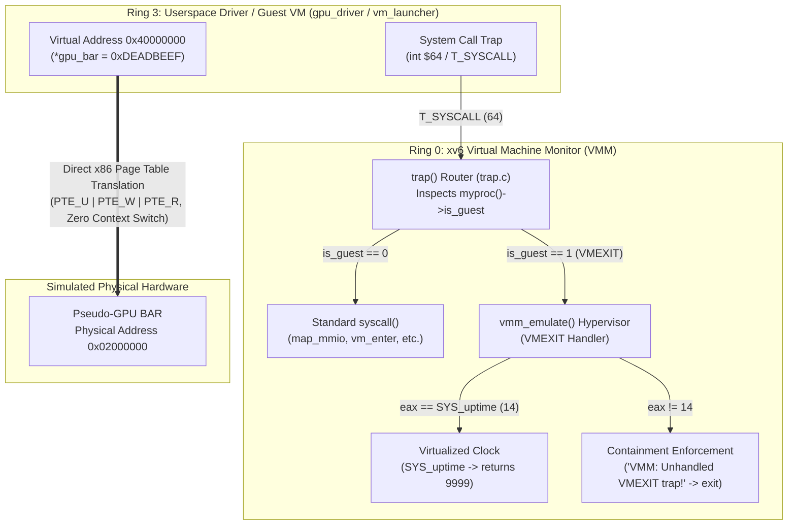
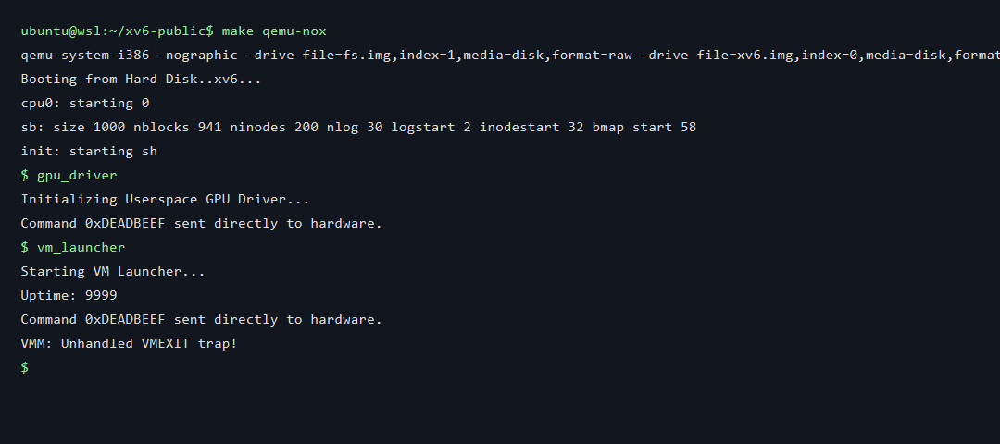

# xv6 Lightweight Virtualization (VMM) & Userspace GPU MMIO Passthrough

-blue?style=flat-square)


> **CS309L: Operating Systems Laboratory — Assignment 5**  
> **Author:** Ch Venkata Sai Pranav Tej (`CS24B057`)  
> **Institution:** Indian Institute of Technology Tirupati (IIT Tirupati)  
> **Instructor:** Prof. Chalavadi Vishnu

---

## Overview

This repository transforms the classic **MIT xv6 (x86)** monolithic kernel into a lightweight **Virtual Machine Monitor (VMM)** capable of isolating user processes as **Guest VMs**, intercepting their privileged operations (`VMEXIT`), and providing zero-copy **Userspace MMIO Passthrough** to a simulated hardware GPU Base Address Register (`BAR`):

| Subsystem | Kernel & User Components | Key Engineering Highlights |
| :--- | :--- | :--- |
| **1. Microkernel Userspace MMIO Passthrough** | `vm.c`, `kalloc.c`, `mmu.h`, `sysproc.c`, `gpu_driver.c` | Reserves physical page `0x02000000` (`GPU_PHYADDR`) outside `kmem.freelist`; implements `sys_map_mmio(uint vaddr)` mapping `0x02000000` directly into Ring 3 (`0x40000000`) with `PTE_U \| PTE_W \| PTE_R`; guards `deallocuvm()` against freeing reserved MMIO frames on process exit; enforces page-alignment and heap/stack non-overlap checks. |
| **2. Trap-and-Emulate Hypervisor (VMM)** | `proc.h`, `proc.c`, `trap.c`, `sysproc.c` | Adds `int is_guest` to `struct proc` and `sys_vm_enter()`; intercepts `T_SYSCALL` (`int $64`) for Guest VMs and routes to `vmm_emulate()`; virtualizes hardware clock (`SYS_uptime` $\rightarrow$ `9999`) and enforces strict guest containment (`VMM: Unhandled VMEXIT trap!`) on unauthorized host system calls. |
| **3. Unified VMM Launcher & Threat Analysis** | `vm_launcher.c`, `docs/TECHNICAL_ARCHITECTURE.md` | End-to-end QEMU-style launcher establishing GPU MMIO passthrough, entering Guest Mode, verifying virtualized `9999` uptime, and writing `0xDEADBEEF` directly to hardware from Ring 3. |

---

## Repository Structure

```text
.
├── README.md                              # Project overview, architecture, and verification guide
├── LICENSE                                # MIT License (MIT PDOS + 2026 Ch Venkata Sai Pranav Tej)
├── Assignment5.pdf                        # Original CS309L Assignment 5 Problem Specification
├── assignment5.patch                      # Unified git diff patch against clean xv6-public
├── assignment4.patch                      # Identical patch file matching Section 4 CLI filename
├── screenshot_vmm_gpu_passthrough.png     # Terminal screenshot of gpu_driver & vm_launcher in QEMU
├── test_vmm_output.txt                    # Raw serial log from headless QEMU execution
├── docs/
│   └── TECHNICAL_ARCHITECTURE.md          # End-to-end kernel walkthrough & security threat analysis
└── xv6-public/                            # Modified MIT xv6 (x86) kernel & userspace drivers
    ├── README.md                          # Guide to modified files inside xv6-public
    ├── mmu.h                              # PTE_R (0x001) and GPU_PHYADDR (0x02000000) definitions
    ├── kalloc.c                           # Reserves physical page 0x02000000 in freerange()
    ├── vm.c                               # Exposes mappages() & protects MMIO BAR in deallocuvm()
    ├── proc.h / proc.c                    # Guest VM state tracking (int is_guest)
    ├── syscall.h / syscall.c / usys.S     # Registers SYS_map_mmio (22) & SYS_vm_enter (23)
    ├── sysproc.c                          # Implements sys_map_mmio(uint) and sys_vm_enter(void)
    ├── trap.c                             # Hypervisor trap router & vmm_emulate() implementation
    ├── gpu_driver.c                       # Ring 3 Userspace GPU MMIO Driver (Listing 1)
    └── vm_launcher.c                      # Unified Guest VM & GPU Passthrough Launcher (Section 3)
```

---

## System Architecture



> [!TIP]
> For an in-depth walkthrough of the kernel page-table mechanics, `deallocuvm()` double-free prevention, and the Section 3 security & threat analysis (DMA attacks, IOMMU isolation, Popek-Goldberg sensitive instructions), read [**docs/TECHNICAL_ARCHITECTURE.md**](docs/TECHNICAL_ARCHITECTURE.md).

---

## Quickstart: Building & Running in QEMU

### Apply Patch to a Clean `xv6-public` Repository (Optional)

```bash
git clone https://github.com/mit-pdos/xv6-public.git
cd xv6-public
git apply ../assignment5.patch
```

### Build & Boot in Headless QEMU

```bash
cd xv6-public
make clean
make qemu-nox
```

### Run the Verification Programs Inside xv6

At the xv6 `$` prompt:

```sh
$ gpu_driver
Initializing Userspace GPU Driver...
Command 0xDEADBEEF sent directly to hardware.
$ vm_launcher
=== Initializing VM Launcher (Lightweight VMM & GPU Passthrough) ===
[Host] MMIO guard checks passed (unaligned & low-memory VAs rejected).
[Host] Mapped Pseudo-GPU BAR (PA 0x02000000) -> VA 0x40000000.
[Host] Entering Guest VM Mode via vm_enter()...
Emulated Uptime: 9999
Command 0xDEADBEEF sent directly to hardware.
VMM: Unhandled VMEXIT trap!
```



---

## Summary of New System Calls

| Syscall Number | Signature | Description |
| :---: | :--- | :--- |
| `22` | `int map_mmio(uint vaddr)` | Validates `vaddr` (page-aligned, non-overlapping `[0, p->sz)`, `< KERNBASE`) and maps reserved physical BAR `0x02000000` with `PTE_U \| PTE_W \| PTE_R`. |
| `23` | `int vm_enter(void)` | Isolates the calling process as a Guest VM (`myproc()->is_guest = 1`), routing all subsequent `T_SYSCALL` traps to `vmm_emulate()`. |

---

## License

This project is licensed under the **MIT License** — see the [LICENSE](LICENSE) file for details. Original xv6 kernel code is Copyright (c) 2006–2018 Frans Kaashoek, Robert Morris, Russ Cox, Massachusetts Institute of Technology. Lightweight VMM and GPU MMIO passthrough extensions are Copyright (c) 2026 Ch Venkata Sai Pranav Tej (`CS24B057`).
