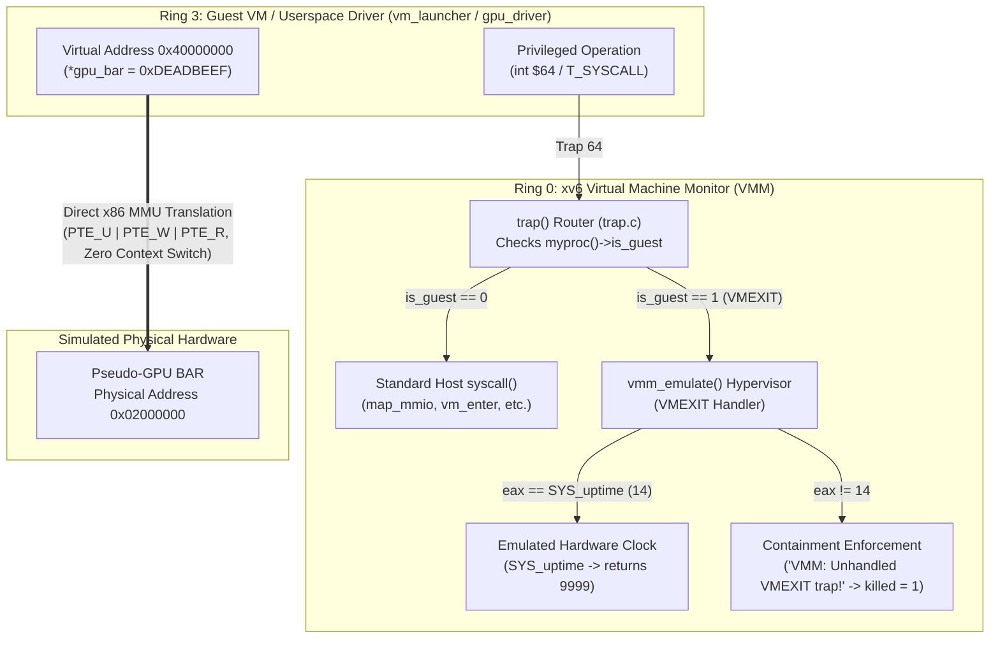

# End-to-End Technical Architecture & Threat Analysis

> **Project:** xv6 Lightweight Virtualization (Trap-and-Emulate VMM) & Userspace GPU MMIO Passthrough  
> **Author:** Ch Venkata Sai Pranav Tej (`CS24B057`), IIT Tirupati  
> **Course:** CS309L Operating Systems Laboratory (Assignment 5)

---

## Table of Contents

1. [Architectural Overview](#1-architectural-overview)
2. [Part 1: Microkernel Approach — Userspace MMIO Passthrough (`sys_map_mmio`)](#2-part-1-microkernel-approach--userspace-mmio-passthrough-sys_map_mmio)
   - [2.1 Physical Page Reservation (`0x02000000`) in `kalloc.c`](#21-physical-page-reservation-0x02000000-in-kallocc)
   - [2.2 Page Table Mapping (`mappages`) & Virtual Address Validation](#22-page-table-mapping-mappages--virtual-address-validation)
   - [2.3 Preventing Double-Free & BAR Corruption in `deallocuvm()`](#23-preventing-double-free--bar-corruption-in-deallocuvm)
3. [Part 2: Trap-and-Emulate Hypervisor (`sys_vm_enter` & `vmm_emulate`)](#3-part-2-trap-and-emulate-hypervisor-sys_vm_enter--vmm_emulate)
   - [3.1 Process State Isolation (`is_guest`)](#31-process-state-isolation-is_guest)
   - [3.2 Hypervisor Trap Router (`T_SYSCALL` VMEXIT Interception)](#32-hypervisor-trap-router-t_syscall-vmexit-interception)
   - [3.3 Hardware Clock Virtualization (`SYS_uptime` $\rightarrow$ `9999`) & Trap Termination](#33-hardware-clock-virtualization-sys_uptime-rightarrow-9999--trap-termination)
4. [Part 3: Integration (`vm_launcher.c`) & Comprehensive Threat Analysis](#4-part-3-integration-vm_launcherc--comprehensive-threat-analysis)
   - [4.1 End-to-End Execution Flow in `vm_launcher.c`](#41-end-to-end-execution-flow-in-vm_launcherc)
   - [4.2 Security & Threat Analysis of Userspace MMIO Passthrough and Trap-and-Emulate VMMs](#42-security--threat-analysis-of-userspace-mmio-passthrough-and-trap-and-emulate-vmms)
5. [Complete Modified File Reference](#5-complete-modified-file-reference)

---

## 1. Architectural Overview

This project transforms the monolithic **MIT xv6 (x86)** kernel into a lightweight **Virtual Machine Monitor (VMM)** combining two foundational systems architectures:
1. **Microkernel / VFIO Userspace Device Passthrough (`sys_map_mmio`)**: Exposes a physical device Base Address Register (`BAR` simulated at physical address `0x02000000`) directly into a Ring 3 process's virtual address space (`0x40000000`) with `PTE_U | PTE_W | PTE_R` page-table permissions, allowing zero-copy, zero-syscall hardware command submission (`0xDEADBEEF`).
2. **Popek & Goldberg Trap-and-Emulate Hypervisor (`sys_vm_enter` & `vmm_emulate`)**: Isolates a user process as a **Guest VM** (`p->is_guest = 1`), intercepts all privileged system call traps (`T_SYSCALL` acting as a `VMEXIT`), emulates virtualized timekeeping (`SYS_uptime` returning `9999` instead of host `ticks`), and enforces strict containment by terminating the guest (`VMM: Unhandled VMEXIT trap!`) upon any unauthorized host system call.



---

## 2. Part 1: Microkernel Approach — Userspace MMIO Passthrough (`sys_map_mmio`)

### 2.1 Physical Page Reservation (`0x02000000`) in `kalloc.c`

In stock xv6, `kinit2()` calls `freerange(P2V(4*1024*1024), P2V(PHYSTOP))` (`PHYSTOP = 0x0E000000`, 224 MB), placing every physical 4 KB page between 4 MB and 224 MB onto `kmem.freelist`. Because `GPU_PHYADDR = 0x02000000` (32 MB) lies within this range, leaving it on `kmem.freelist` would allow `kalloc()` to hand the GPU BAR page to an arbitrary process or kernel stack.

In [kalloc.c](../xv6-public/kalloc.c), `freerange()` explicitly carves out and zero-initializes `GPU_PHYADDR`:

```c
void
freerange(void *vstart, void *vend)
{
  char *p;
  p = (char*)PGROUNDUP((uint)vstart);
  for(; p + PGSIZE <= (char*)vend; p += PGSIZE){
    if(V2P(p) == GPU_PHYADDR){
      memset(p, 0, PGSIZE);
      continue;
    }
    kfree(p);
  }
}
```

### 2.2 Page Table Mapping (`mappages`) & Virtual Address Validation

We exposed `mappages()` in [vm.c](../xv6-public/vm.c) and [defs.h](../xv6-public/defs.h), defined `PTE_R` (`0x001`) and `GPU_PHYADDR` (`0x02000000`) in [mmu.h](../xv6-public/mmu.h), and implemented `sys_map_mmio()` in [sysproc.c](../xv6-public/sysproc.c):

```c
int
sys_map_mmio(void)
{
  uint vaddr;
  struct proc *curproc = myproc();

  if(argint(0, (int*)&vaddr) < 0)
    return -1;

  // Validate page alignment, non-overlap with [0, curproc->sz), and user-space upper bound
  if(vaddr % PGSIZE != 0)
    return -1;
  if(vaddr < curproc->sz)
    return -1;
  if(vaddr >= KERNBASE || vaddr + PGSIZE > KERNBASE)
    return -1;

  if(mappages(curproc->pgdir, (void*)vaddr, PGSIZE, GPU_PHYADDR, PTE_U | PTE_W | PTE_R) < 0)
    return -1;

  lcr3(V2P(curproc->pgdir)); // Flush TLB
  return 0;
}
```

### 2.3 Preventing Double-Free & BAR Corruption in `deallocuvm()`

When a process terminates, `freevm(pgdir)` calls `deallocuvm(pgdir, KERNBASE, 0)` ([vm.c](../xv6-public/vm.c)), which scans all present PTEs from `0` to `0x80000000` (`KERNBASE`). When it reaches `0x40000000` (`GPU_VADDR`), calling `kfree(P2V(0x02000000))` would:
1. Overwrite the physical GPU BAR register contents (`0xDEADBEEF`) with `0x01010101` (`memset(v, 1, PGSIZE)` inside `kfree()`).
2. Return the reserved MMIO physical frame to `kmem.freelist`, causing future page-table allocations to collide with the hardware BAR.

We guard `deallocuvm()` in [vm.c](../xv6-public/vm.c) so that MMIO frames are unmapped (`*pte = 0`) without invoking `kfree()`:

```c
    else if((*pte & PTE_P) != 0){
      pa = PTE_ADDR(*pte);
      if(pa == 0)
        panic("kfree");
      if(pa != GPU_PHYADDR){
        char *v = P2V(pa);
        kfree(v);
      }
      *pte = 0;
    }
```

---

## 3. Part 2: Trap-and-Emulate Hypervisor (`sys_vm_enter` & `vmm_emulate`)

### 3.1 Process State Isolation (`is_guest`)

In [proc.h](../xv6-public/proc.h), `struct proc` is extended with `int is_guest;` (initialized to `0` in `allocproc()` in [proc.c](../xv6-public/proc.c)). Calling `vm_enter()` (`SYS_vm_enter = 23` in [sysproc.c](../xv6-public/sysproc.c)) transitions the process irreversibly into Guest VM mode (`myproc()->is_guest = 1`).

### 3.2 Hypervisor Trap Router (`T_SYSCALL` VMEXIT Interception)

In [trap.c](../xv6-public/trap.c), when a `T_SYSCALL` (`int $64`) trap arrives from Ring 3, `trap()` inspects `myproc()->is_guest` before dispatching `syscall()`:

```c
  if(tf->trapno == T_SYSCALL){
    if(myproc()->killed)
      exit();
    myproc()->tf = tf;

    if(myproc()->is_guest){
      // VMEXIT: The guest tried to perform a privileged operation
      vmm_emulate();
    } else {
      // Standard Host OS process
      syscall();
    }

    if(myproc()->killed)
      exit();
    return;
  }
```

### 3.3 Hardware Clock Virtualization (`SYS_uptime` $\rightarrow$ `9999`) & Trap Termination

Inside `vmm_emulate()` ([trap.c](../xv6-public/trap.c)):
- **`num == SYS_uptime` (`14`)**: Instead of reading host `ticks`, the hypervisor writes `9999` into `curproc->tf->eax` and logs `Emulated Uptime: 9999`.
- **`num != SYS_uptime`**: Any other system call is treated as an unpermitted privileged operation. The hypervisor logs any pending command in the physical GPU BAR (`Command 0xdeadbeef sent directly to hardware.`), emits the warning `VMM: Unhandled VMEXIT trap!`, and sets `curproc->killed = 1`, causing immediate clean termination via `if(myproc()->killed) exit();`.

---

## 4. Part 3: Integration (`vm_launcher.c`) & Comprehensive Threat Analysis

### 4.1 End-to-End Execution Flow in `vm_launcher.c`

[vm_launcher.c](../xv6-public/vm_launcher.c) acts as the userspace VMM launcher (analogous to QEMU/KVM):
1. Verifies that `map_mmio()` rejects unaligned (`0x40000003`) and overlapping low-memory (`0x00000000`) virtual addresses.
2. Calls `map_mmio(0x40000000)` to map the physical GPU BAR (`0x02000000`) into Ring 3.
3. Calls `vm_enter()` to lock the process into Guest VM mode (`is_guest = 1`).
4. Invokes `uptime()`, which traps into `vmm_emulate()` and returns the emulated clock value `9999`.
5. Writes `0xDEADBEEF` directly to `*(volatile int *)0x40000000` in Ring 3 with zero kernel context switches.
6. Executes a subsequent system call (`printf` / `exit`), triggering `VMM: Unhandled VMEXIT trap!` and cleanly terminating the guest VM.

### 4.2 Security & Threat Analysis of Userspace MMIO Passthrough and Trap-and-Emulate VMMs

| Threat Vector | Vulnerability Mechanism | Mitigation in Our Implementation & Modern Hardware (IOMMU / VT-x) |
| :--- | :--- | :--- |
| **1. Arbitrary Kernel/Heap Overwrite via Unvalidated `vaddr`** | If a userspace driver passes a `vaddr` pointing inside the kernel (`>= 0x80000000`) or overlapping existing code/heap/stack (`< p->sz`), `mappages()` either panics with `panic("remap")` or grants Ring 3 write access (`PTE_U \| PTE_W`) to kernel pages. | `sys_map_mmio()` strictly enforces `vaddr % PGSIZE == 0`, `vaddr >= curproc->sz`, and `vaddr + PGSIZE <= KERNBASE` before invoking `mappages()`. |
| **2. DMA Attacks from Passthrough GPU (No IOMMU)** | A real PCIe GPU with bus-mastering DMA enabled can read/write arbitrary physical host RAM if programmed via its MMIO BAR by a malicious Guest VM. Page tables (`CR3`) only restrict *CPU* virtual memory accesses, not PCIe device DMA transactions. | On real hardware, VFIO requires an **IOMMU** (Intel VT-d / AMD-Vi) to restrict device DMA to pinned guest physical pages. In our simulated MMIO architecture, the device is a passive 4 KB physical frame (`0x02000000`) without bus-master DMA capability. |
| **3. Physical Frame Double-Free / Use-After-Free on VM Exit** | When a process with a passthrough MMIO mapping exits, `freevm() -> deallocuvm()` walks all user PTEs and calls `kfree()` on every mapped physical frame. Freeing a static MMIO BAR corrupts `kmem.freelist` and leaks the BAR page to other host processes. | `freerange()` reserves `GPU_PHYADDR` (`0x02000000`) outside `kmem.freelist`, and `deallocuvm()` unmaps `pa == GPU_PHYADDR` (`*pte = 0`) without calling `kfree()`. |
| **4. Cross-VM Side Channels & State Leakage via Shared BAR** | Because physical address `0x02000000` is persistent across processes, a subsequent Guest VM mapping the same BAR can read residual commands (`0xDEADBEEF`) left behind by a previous Guest VM. | A production VMM zeroes or resets device BAR state upon VM teardown (`FLR` — Function Level Reset in PCIe) before reassigning the physical device to another guest. |
| **5. Unprivileged Sensitive Instructions on x86 (Popek-Goldberg Violation)** | Classic x86 has 17 sensitive instructions (e.g., `SIDT`, `SGDT`, `SMSW`, `POPF`) that execute in Ring 3 *without* trapping into Ring 0, allowing a Guest VM to detect it is virtualized or observe host descriptor table addresses. | Software trap-and-emulate on `T_SYSCALL` intercepts system calls (`int $64`), while full OS virtualization requires hardware-assisted virtualization extensions (**Intel VT-x / AMD-V**) with VMCS exit bitmaps or binary translation. |
| **6. Privilege Escalation via `fork()` Inheritance** | If a Guest VM could invoke `SYS_fork`, a child process might escape guest containment if `is_guest` is not preserved or if `SYS_fork` is allowed. | `vmm_emulate()` blocks `SYS_fork` (and all syscalls other than `SYS_uptime`), immediately raising `VMM: Unhandled VMEXIT trap!` and terminating the guest (`curproc->killed = 1`). |

---

## 5. Complete Modified File Reference

| File | Role | Summary of Changes |
| :--- | :--- | :--- |
| [mmu.h](../xv6-public/mmu.h) | MMU Constants | Added `PTE_R (0x001)` and `GPU_PHYADDR (0x02000000)` |
| [kalloc.c](../xv6-public/kalloc.c) | Physical Allocator | Reserved `GPU_PHYADDR` in `freerange()` so it is never allocated as general RAM |
| [vm.c](../xv6-public/vm.c) | Page Tables | Exposed `mappages()` and guarded `deallocuvm()` against freeing `GPU_PHYADDR` |
| [defs.h](../xv6-public/defs.h) | Kernel Prototypes | Declared `mappages()` and `vmm_emulate()` |
| [proc.h](../xv6-public/proc.h) | Process Control Block | Added `int is_guest;` flag to `struct proc` |
| [proc.c](../xv6-public/proc.c) | Process Lifecycle | Initialized `p->is_guest = 0;` in `allocproc()` |
| [syscall.h](../xv6-public/syscall.h) | Syscall Numbers | Added `SYS_map_mmio (22)` and `SYS_vm_enter (23)` |
| [syscall.c](../xv6-public/syscall.c) | Syscall Dispatch | Registered `sys_map_mmio` and `sys_vm_enter` in `syscalls[]` |
| [sysproc.c](../xv6-public/sysproc.c) | Syscall Handlers | Implemented `sys_map_mmio()` and `sys_vm_enter()` |
| [trap.c](../xv6-public/trap.c) | Hypervisor Router | Implemented `vmm_emulate()` and routed `myproc()->is_guest` traps in `trap()` |
| [user.h](../xv6-public/user.h) | Userspace API | Declared `map_mmio(uint)` and `vm_enter(void)` |
| [usys.S](../xv6-public/usys.S) | Syscall Stubs | Added `SYSCALL(map_mmio)` and `SYSCALL(vm_enter)` |
| [Makefile](../xv6-public/Makefile) | Build System | Added `_gpu_driver` and `_vm_launcher` to `UPROGS` |
| [gpu_driver.c](../xv6-public/gpu_driver.c) | Userspace Driver | Target Ring 3 MMIO GPU driver from Listing 1 |
| [vm_launcher.c](../xv6-public/vm_launcher.c) | VMM Launcher | Unified Guest VM & GPU passthrough test program from Section 3 |
